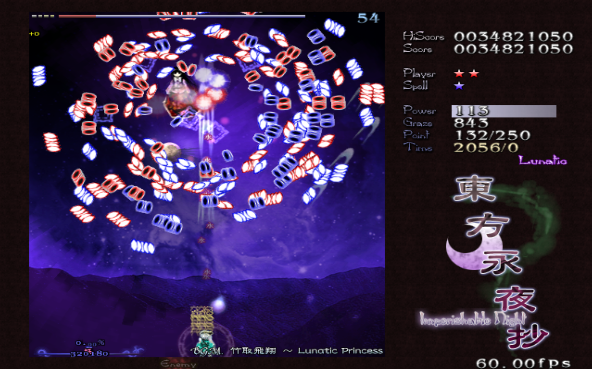

# Native 64-bit Linux port

TH08 now has a native-layout 64-bit Linux build alongside the original
fixed-layout i386 port. Both products compile the reconstructed authored game
sources and use the repository SDL2/OpenGL backend. Supply your own original
game data to run them.

Stable packages are available from the
[latest TH08 release](https://github.com/N0zoM1z0/th08/releases/latest).
Active development and CI snapshots remain on
[`port/portable-64bit`](https://github.com/N0zoM1z0/th08/tree/port/portable-64bit).

## Architecture status

| Architecture | Build verification | Runtime verification |
| --- | --- | --- |
| x86_64 | ELF64 little-endian PIE; native globals; no fixed-address TH08 symbols | Complete Sakuya/Remilia Lunatic route through Stages 1–6A, ending, results, and return to title under WSLg; additional Stage 4A and Stage 6B Practice validation; deterministic replay audits under Xvfb/Mesa |
| AArch64 | Cross-built ELF64 little-endian PIE with only AArch64 libraries | QEMU user-mode reaches DAT/version/logo/loading initialization; a real AArch64 desktop gameplay run remains required |

Native x86_64 gameplay and replay audits have run under WSLg and Xvfb/Mesa.
AArch64 has cross-build, packaging, and QEMU startup evidence; gameplay on real
AArch64 hardware remains the next gate.

<p align="center">
  
</p>

The image above is from the product-ready x86_64 build in Stage 6B, with normal
life rules and no render-audit or automation patch. Maintainer bias, openly
declared: Kaguya is my favorite, and **竹取飛翔 ～ Lunatic Princess** is
my favorite track. XD

## Runtime data

Supply a legally obtained original Japanese TH08 data directory containing:

- `th08.dat`
- `thbgm.dat`

Start a packaged build with:

```bash
./run-th08.sh "/path/to/original/TH08 directory"
```

On Debian/Ubuntu x86_64, packaged runtime dependencies are:

```bash
sudo apt-get install \
  libstdc++6 libgl1 libfontconfig1 \
  libsdl2-2.0-0 libsdl2-image-2.0-0 libsdl2-ttf-2.0-0 \
  fonts-vlgothic
```

Install the corresponding native packages on an AArch64 distribution.

The selected directory must be writable. TH08 creates configuration, score,
backup, replay, screenshot, and diagnostic files there. The port does not need
the original executable at runtime.

## Build

On an x86_64 Debian/Ubuntu host, install the native development libraries:

```bash
sudo apt-get install \
  g++ cmake ninja-build pkg-config \
  libsdl2-dev libsdl2-image-dev libsdl2-ttf-dev \
  libfontconfig1-dev libgl-dev
```

Then build and verify x86_64:

```bash
git switch port/portable-64bit
scripts/build-portable-linux.sh x86_64
```

For an AArch64 cross-build on the same host:

```bash
sudo dpkg --add-architecture arm64
sudo apt-get update
sudo apt-get install \
  g++-aarch64-linux-gnu \
  libsdl2-dev:arm64 libsdl2-image-dev:arm64 libsdl2-ttf-dev:arm64 \
  libfontconfig1-dev:arm64 libgl-dev:arm64
scripts/build-portable-linux.sh aarch64
```

On a native AArch64 host, the same command uses the host compiler rather than
the cross toolchain. Outputs are:

- `build/portable-linux-x86_64/th08-modern`
- `build/portable-linux-aarch64/th08-modern`

Create redistributable source-built archives with:

```bash
scripts/package-portable-linux.sh \
  build/portable-linux-x86_64/th08-modern x86_64
scripts/package-portable-linux.sh \
  build/portable-linux-aarch64/th08-modern aarch64
```

## Verification

Static verification rejects the old fixed-address i386 ownership model and
checks the requested ELF machine:

```bash
scripts/verify-portable-linux.sh \
  build/portable-linux-x86_64/th08-modern x86_64
scripts/verify-portable-linux.sh \
  build/portable-linux-aarch64/th08-modern aarch64
```

On a graphical x86_64 host, the isolated gameplay smoke test uses symlinks to
the two original archives, writes everything else below `build/`, and requires
the game to progress from the title screen into the bundled Stage 5 demo:

```bash
scripts/smoke-test-portable-linux.sh \
  build/portable-linux-x86_64/th08-modern \
  "/path/to/original/TH08 directory" 40
```

The check fails on an early exit, `modern-crash.txt`, or failure to request the
title, replay, SHT, STD, ECL, and message resources used by that route.

### Native-layout performance boundary

The reconstructed game translation units continue to compile with `-O0`.
That is intentional: their source shape remains shared with the VC7 exact
build, and changing their optimization policy would blur the reconstruction
and port boundaries. For native-layout Linux builds only, CMake compiles the
three handwritten hot adapters at `-O2 -fno-strict-aliasing`:

- `src/modern/linux/d3d8_compat.cpp`;
- `src/modern/linux/d3dx8_compat.cpp`;
- `src/modern/linux/linux_compat.cpp`.

These files own the per-vertex renderer, pixel conversion, SDL timing/input,
and compatibility calls. The fixed-layout i386 build and the game translation
units retain their preceding flags. Inspect the effective boundary with:

```bash
ninja -C build/portable-linux-x86_64 -t commands |
  rg 'src/(modern/linux/(d3d8_compat|d3dx8_compat|linux_compat)|Global)\.cpp'
```

On the same x86_64 host, data, Xvfb display, and llvmpipe renderer, an external
`SDL_GL_SwapWindow` counter measured the first 1,200 swaps in the game's FPS
calibration path at 13.485 seconds with all adapters at `-O0` and 3.442 seconds
with this bounded policy, a 3.92x improvement. Post-calibration samples remain
capped at approximately 60 Hz as intended. This measurement demonstrates the
adapter bottleneck and additional frame-time headroom under those conditions.
Dense patterns and other GPU/driver combinations need separate profiling.

### AddressSanitizer runtime audit

Build an isolated sanitizer artifact without changing the normal package:

```bash
CXXFLAGS='-fsanitize=address -fno-omit-frame-pointer' \
LDFLAGS='-fsanitize=address' \
TH08_PORTABLE_BUILD_DIR=build/portable-linux-x86_64-asan \
  scripts/build-portable-linux.sh x86_64
```

The Linux crash reporter normally owns the fatal signals. Disable it for the
sanitizer process so AddressSanitizer can report the first failing access:

```bash
ASAN_OPTIONS='detect_leaks=0:halt_on_error=1:handle_segv=0:handle_abort=0:handle_sigfpe=0' \
TH08_DISABLE_CRASH_REPORTER=1 \
  scripts/smoke-test-portable-linux.sh \
    build/portable-linux-x86_64-asan/th08-modern \
    "/path/to/original/TH08 directory" 60
```

`TH08_DISABLE_CRASH_REPORTER` is diagnostic-only and does not affect packaged
normal runs. The audit exposed and now guards these modern-runtime hazards:

- the target `Lzss::Decode @ 0x004740E0` fetches a byte before checking the
  input end; the modern path checks the bound first while the VC7 path retains
  the target order;
- encrypted resources lose a four-byte signature during decryption, but the
  target leaves the reported size unchanged; the modern path now reports the
  actual returned allocation size, preventing SDL_image from reading past a
  complete JPEG's `FF D9` terminator;
- legacy arrays with trivial element destruction in streaming audio, the title
  VM pool, Music Room, and shortcut resolution were allocated with `new[]` and
  released through scalar `delete`; modern builds now pair those allocations
  with `delete[]` while the target-facing path retains its observed
  scalar-delete calls.

The 60-second sanitizer smoke covers title, bundled replay, Stage 5 resource
loading, BGM startup, and return-to-title cleanup. Extend it with selected
replay windows to check later stages and routes.

### Issue-driven prerequisite regression gate

The native Windows i386 prerequisite recovered production-source defects that
also feed the 64-bit build. The current portable branch therefore checks the
shared repairs:

- dialogue and stage rendering share the target's stage-finished draw gate;
- boss names select the GUI front-ANM owner;
- player gauge thresholds reside in the live `GameManager` object;
- spell backgrounds select the EffectManager stage-effect ANM;
- target-initialized effect, Last Spell, bonus, and palette tables have normal
  C++ owners;
- player-shot RNG and numeric-popup callees match their target mappings.

These paths correspond to several symptoms reported in
[th08 issue #16](https://github.com/N0zoM1z0/th08/issues/16) and
[th08-web issue #1](https://github.com/N0zoM1z0/th08-web/issues/1). The native
x86_64 smoke test reaches the bundled Stage 5 demo and guards early exits and
resource requests. The [native replay gate](REPLAY_TESTING.md) checks complete
input/RNG traces on the VC7 product. Portable visual reports and the post-spell
gauge, result-screen, and negative-bonus symptoms need a stage, replay, and
runtime capture of their own.

### Native replay repair checks

The branch includes [main PR #26](https://github.com/N0zoM1z0/th08/pull/26):
Fantasy Seal trajectories, death-mode orbit lifetime, spellcard callback
ownership, laser-cancel trigonometry, and Solo Yukari's replay-fed input.
The [committed corpus](../tests/fixtures/replays/th08-1.00d/README.md) preserves
the original recordings, author credits, and pinned provenance.

Build the portable artifact, then run the six bounded replay windows:

```bash
scripts/build-portable-linux.sh x86_64
python3 scripts/test-portable-replay-repairs.py \
  --candidate build/portable-linux-x86_64/th08-modern \
  --game-data-dir "/path/to/original/TH08 directory" \
  --output-dir build/portable-replay-check
```

| Window | Replay case | Start stage | Seconds |
| --- | --- | --- | ---: |
| `border-transitions` | `easy-0-b` | Stage 1 | 90 |
| `yukari-stage3` | `easy-5-b` | Stage 3 | 90 |
| `border-stage5` | `lunatic-0-b` | Stage 5 | 90 |
| `magic-final-a` | `lunatic-1-a` | Final A | 60 |
| `ghost-final-b` | `lunatic-3-b` | Final B | 60 |
| `scarlet-extra` | `extra-2-extra` | Extra | 60 |

The runner verifies recording bytes, disables audio, uses normal life rules,
and checks enemy texture, geometry, and framebuffer evidence. It records the
binary/data hashes and playback settings, retains compressed per-window reports,
and removes each temporary runtime. A failure stops the batch with its evidence
retained. `--windows yukari-stage3,border-stage5` selects individual checks;
use a new output directory for each run.

These windows establish bounded portable replay/render coverage. The full
108-case, 25-field parity claim belongs to the separate VC7 replay gate.

The 2026-10-12 run at source commit `2c253eb2` passed all six windows, with
5,231 samples. Fresh x86_64 ownership checks, normal and AddressSanitizer
60-second smoke runs, and repository CI also passed. The merged source retained
all 1,106 accepted VC7 units after a cold build and passed fresh normal/bugfix
link checks. Reports and compressed logs are in `build/replay-cold-20261011/`.

The Stage 5 window contains one `color-loss-suspect` sample at frame 6,166,
enemy 14, sprite 77, alongside 72 `ok` samples for the same animation/script/
sprite. The checker reports isolated suspects and fails structural errors or
repeated zero-pixel draws. This sample needs visual confirmation; the retained
CSV records its texture, tint, geometry, and framebuffer delta.

Same-frame retail comparison subsequently exposed a Stage 5 background
perspective difference. [PORTABLE_BACKGROUND.md](PORTABLE_BACKGROUND.md) records
the camera/vertex investigation, the confirmed loss of clip `W`, and a reusable
isolated experiment. The production rendering repair is pending.

The [portable runtime review](PORTABLE_RUNTIME_REVIEW.md) extends that defect
to Stage 1, Stage 3, and Final B, confirms stale HOME screenshots and next-frame
overwrite, and isolates fullscreen cropping under Xvfb without a window manager.
It provides reusable display and same-frame comparison commands.

### Deterministic replay render audit

For regressions that are difficult to recognize from a crash log, the native
Linux build has an opt-in enemy-render oracle. It starts a selected stage from
a user-supplied replay, samples the selected ANM texture region, brackets the
actual draw with framebuffer reads, and records the VM geometry, color state,
draw result, and pixel delta. The audit is off during normal play.

```bash
scripts/audit-render-replay-linux.sh \
  build/portable-linux-x86_64/th08-modern \
  "/path/to/original/TH08 directory" \
  "/path/to/th8_01.rpy" \
  3 180
```

The stage index is zero-based (`3` is Stage 4); the final argument is the audit
window in seconds. The script runs in an isolated Xvfb/llvmpipe directory,
advances replay frames faster than wall clock, and writes the last report to
`build/render-audit-last.csv`. It fails on missing or empty sprite data,
invalid geometry, a crash, or a repeatedly queued draw that never changes the
framebuffer. Low-intensity ANM color modulation is included in the expected
texture statistics so scripted fades are not mistaken for missing art. The
audit launcher applies its endurance patch externally through GDB; set
`TH08_RENDER_AUDIT_KEEP_LIVES=0` to audit with normal life rules. Neither mode
modifies the executable or the behavior of a packaged build.

The audit checks primary enemy and boss VM state and pixels. Use graphical
captures for backgrounds, bullets, secondary VMs, and broader visual comparisons.
The [render-audit guide](RENDER_AUDIT.md) defines the versioned CSV contract,
acceptance policy, cross-port comparator, and adapter boundary for future
platform backends.

## Why a separate native layout exists

The exact reconstruction remains a 32-bit VC7 product. The i386 Linux port also
uses 32-bit pointers and a linker script that preserves target virtual
addresses. A 64-bit PIE cannot safely inherit either assumption.

The 64-bit build therefore defines `TH08_PORTABLE_NATIVE_LAYOUT` and keeps two
kinds of structure distinct:

- serialized files retain their original 32-bit offsets and exact byte sizes;
- live runtime objects use native pointers and native alignment.

Loaders now resolve, without truncation, the pointer-like fields in stage
background (`.std`), ECL, player shot (`.sht`), message, and replay data. Replay
save/load keeps the version-6 wire format compatible while maintaining a
native pointer table outside the serialized `0x134`-byte record.

The same separation now covers `score.dat`. Its original `0x1c`-byte wire
header remains fixed while the live native score-list pointer is stored after
that header. Existing retail/i386 saves therefore load without being rejected
or silently recreated, and Practice unlock masks survive a 64-bit load/save
round trip.

Three target symbols were alternate names for bytes inside other objects. The
fixed i386 linker script supplied that identity automatically. Native layout
expresses the same ownership in C++: ECL time-scale flags are the Supervisor
flag word, the spell background ANM is the EffectManager field, and the two GUI
screen-effect counters share storage.

Native object clears must follow the live native layout as well. In particular,
`EnemyManager::Initialize` uses `sizeof` for its manager and spawn-template
clears in a native-layout build. Keeping the original 32-bit byte constants in
an ELF64 process left the expanded tail—including timeline state—uncleared and
could stall later stage transitions. The VC7 and fixed-layout paths retain the
target-observed constants.

Compiler stack layout is not a portable aggregate representation. The exact
`EnemyManager::OnDrawImpl` source preserves VC7's adjacent `savedScaleX` and
`savedScaleY` locals, but modern builds save the pair in a real `Float2`.
Treating `&savedScaleX` as an eight-byte vector happened to work on VC7/i386;
on x86_64 GCC, a boss trail restored an unrelated stack value as `scale.y`,
making the boss geometry NaN and invisible. The replay oracle caught the first
bad frame and verified the bounded modern-only correction.

Earlier Linux bring-up runs also exposed missing enemy/boss sprites, incomplete
effects, Stage 4-to-5 dynamic-text tiling, and later-stage transition stalls.
The final x86_64 full-route and Practice passes completed with those fixes.
Reports from other runtimes should include the diagnostics described in
[PLAY_LINUX.md](PLAY_LINUX.md).

The VC7 comparison path uses the original layout and remains a separate gate
for the shared source.
